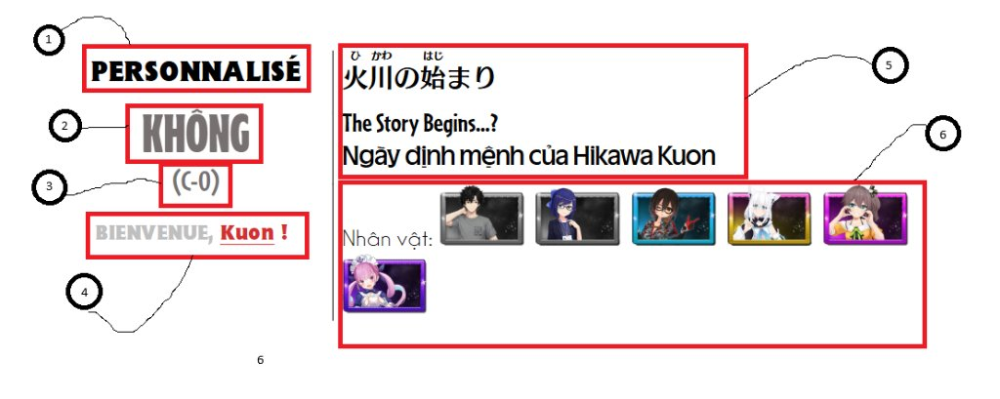

# holoAnime: The Hikawa's Adventure - The Novelization: LaTeX Edition

Nơi lưu trữ mã nguồn của series tiểu thuyết **holoAnime: The Hikawa's Adventure** (phiên bản LaTeX Edition). Đây là dự án tiểu thuyết hóa (Novelization) chuyển thể từ các series anime ngắn 3D vui nhộn của hololive (*holo no Graffiti*), HOLOSTARS (*stars\*collection*) cùng các sản phẩm hoạt hình của các VTuber khác (như Nijisanji, .LIVE...), kết hợp với các nhân vật nguyên tác (Original Characters - OC) do tác giả sáng tạo: gia đình Hikawa và những người bạn.

Phiên bản **LaTeX Edition** thay thế cho các bản thảo Word cũ trước đây, mang lại cấu trúc văn bản bài bản, dàn trang chuẩn xuất bản, quản lý phông chữ chuyên biệt và khả năng biên dịch linh hoạt từng tập hoặc trọn bộ cuốn sách.

---

## 1. Cấu trúc các bộ sách

Toàn bộ các tác phẩm trong dự án được quy hoạch thành **ba phân khu chính**:

```
Book/
├── hnG/       # holo no Graffiti (Tuyến truyện chính)
├── sC/        # stars*collection (Tuyến truyện các nhóm nam HOLOSTARS)
└── Extra/     # Các phần ngoại truyện, sự kiện đặc biệt và bối cảnh mở rộng
```

### 1.1. holo no Graffiti (`Book/hnG/`)
Tuyến truyện cốt lõi dựa trên series hoạt hình 3D ngắn *holo no Graffiti* của hololive, xoay quanh công việc và đời sống thường nhật đầy hỗn loạn của nhân vật chính **Hikawa Kuon** - một chàng trai gốc Việt làm Tổng quản lý cho cả ba chi nhánh hololive (JP, ID, EN):
* **Phase 1 (Round 1 - từ Book P, 0 đến Book 10):** Giai đoạn khởi đầu (2018 - mùa thu 2021). Kuon bắt đầu nhận việc tại văn phòng công ty COVER, làm quen và xoay xở xử lý những trò quậy phá "bất chấp định luật vật lý" của các thế hệ thần tượng từ Gen 0 đến Gen 5 (NePoLaBo).
* **Phase 2 (Round 2 - từ Book 11 trở đi, ft. Hikawa Kaiho):** Giai đoạn mở rộng với sự xuất hiện của người chị gái cá tính Kaiho, chào đón thế hệ bí mật holoX (Gen 6) cùng các chi nhánh quốc tế.
* **Phase 3 (Round 3 - tương lai):** Hành trình tiếp nối của hai chị em nhà Hikawa trong vũ trụ mở rộng.

### 1.2. stars\*collection (`Book/sC/`)
Tuyến truyện ngắn chuyển thể từ series hài hước *stars\*collection* của nhóm nam thần tượng **HOLOSTARS** (Miyabi, Arurandeisu, Rikka, Temma, Roberu, Shien, Oga...):
* Bao gồm các tập sách `BookM1`, `BookM2`, `BookM3`... (M viết tắt của *Male*).
* Cốt truyện theo chân người chị **Hikawa Kaiho** trong những màn tương tác, "đấu trí" và xử lý rắc rối dở khóc dở cười tại căn mancave của các chàng trai.

### 1.3. Extra (`Book/Extra/`)
Tập hợp các tập truyện ngoại truyện, sự kiện theo mùa, thế giới giả lập và các dự án giao lưu (crossover):
* **`BookT` (Tết Nguyên Đán):** Kỳ nghỉ Tết cổ truyền và trải nghiệm văn hóa đón Tết của các cô gái hololive.
* **`BookA` (Kỷ niệm & Sinh nhật):** Những cột mốc sinh nhật, ngày kỷ niệm của Kuon và các idol.
* **`BookD` (Dormitory - Ký túc xá):** Đời sống sinh hoạt thường nhật tại khu ký túc xá gia đình Hikawa cùng các idol (đặc biệt là các câu chuyện giả thuyết dành cho các thành viên đã tốt nghiệp như Aloe, Coco...).
* **`BookB` (Beach / holoSummer):** Các chuyến du lịch biển và lễ hội mùa hè.
* **`BookV` (The Void & Non-Game):** Cuộc phiêu lưu bất đắc dĩ của ba anh chị em Kuon, Kaiho và Suzuno khi bị hút vào lỗ đen không gian *The Void* và rơi vào thế giới kỳ lạ của trò chơi *There Is No Game*.
* **`BookNJ1` (Chocosanji):** Giao lưu cùng các thành viên chi nhánh tiếng Nhật của Nijisanji.
* **`BookER` (hololive ERROR):** Chuyển thể tiểu thuyết từ vũ trụ game kinh dị *hololive ERROR* tại trường nữ sinh thị trấn Aogami.
* **`BookKL` & `BookX`:** Các tập truyện ngắn, hồ sơ nhân vật và kịch bản thử nghiệm độc lập.

---

## 2. Hướng dẫn biên dịch (Build Instructions)

### 2.1. Cài đặt tài nguyên dự án (Asset Setup)
Khi tải hoặc sao chép repository này về máy, kho lưu trữ trên GitHub sẽ chỉ bao gồm mã nguồn và khung mẫu văn bản:
* `Book/`: Mã nguồn LaTeX của toàn bộ các tập sách.
* `Template/`: Các mẫu văn bản và bố cục chuẩn.
* `Tools/`: Các công cụ và tập lệnh hỗ trợ biên soạn.

Do giới hạn dung lượng lưu trữ của GitHub đối với các file media/binary nặng, các thư mục chứa tài nguyên hình ảnh và phông chữ hệ thống được lưu trữ riêng tại liên kết bên ngoài:
* **Gói tài nguyên bổ sung (`Character`, `Cover`, `Fontface`, `Image`, `Logo`):**
  > **Link:** *sẽ cập nhật sau*
* **Cách cài đặt:** Tải gói tài nguyên trên về, giải nén và đặt các thư mục này trực tiếp vào thư mục gốc của repo (ngang hàng với `Book/`, `Template/`, `Tools/`).

---

### 2.2. Yêu cầu môi trường (Prerequisites)
* **Bản phân phối TeX:** Cài đặt **TeX Live** (khuyến nghị bản đầy đủ `scheme-full`) hoặc **MiKTeX**.
* **Trình biên dịch (Engine):** Bắt buộc sử dụng **LuaLaTeX** (hoặc **LuaTeX**).
  > **Quan trọng:** Dự án **không còn hỗ trợ XeTeX / XeLaTeX**. Toàn bộ cấu trúc macro, quản lý bộ nhớ đệm phông chữ và xử lý đa ngữ đã được tối ưu hóa riêng cho LuaLaTeX.

---

### 2.3. Phông chữ yêu cầu (Fonts)
Sau khi giải nén thư mục `Fontface/` từ gói tài nguyên, hãy cài đặt các phông chữ sau vào hệ điều hành của bạn trước khi biên dịch:
* `Burbank Big Condensed`: Dùng cho số thứ tự tập.
* `Cafeteria Bold`: Dùng cho tên tập tiếng Anh và mã tập.
* `Caviar Dreams`: Dùng cho dòng danh sách nhân vật.
* `Fotskip`: Dùng cho tiêu đề tiếng Nhật.
* `VnMSans`: Dùng cho tiêu đề tiếng Việt và các đề mục Việt ngữ.
* `Flare Gothic`: Dùng cho nhãn thể loại, thuộc tính tập và đề mục phụ.
* `Sen`: Dùng cho dòng mốc thời gian / ngày phát hành.

---

### 2.4. Lệnh biên dịch

#### Biên dịch toàn bộ một cuốn sách:
Mở terminal tại thư mục chứa file `main.tex` của cuốn sách cần xuất (ví dụ: `Book/hnG/Phase1/Book0/`) và chạy:
```bash
lualatex --synctex=1 --interaction=nonstopmode main.tex
```
*(Khuyến nghị chạy lệnh 2 lần để hệ thống LaTeX cập nhật chính xác số trang, mục lục và các liên kết chéo `hyperref`).*

#### Biên dịch từng tập riêng lẻ:
Mỗi tập truyện trong thư mục `Episode/` đều sử dụng gói `subfiles`:
```latex
\documentclass[../main.tex]{subfiles}
```
Bạn chỉ cần mở trực tiếp file tập truyện đó (ví dụ: `Episode/0-01.tex`) trong các trình soạn thảo (như VS Code với tiện ích LaTeX Workshop, hoặc TeXstudio) và nhấn **Compile** với engine **LuaLaTeX**. File PDF của riêng tập đó sẽ được tạo ra ngay lập tức mà không cần biên dịch lại cả cuốn sách.

---

### 2.5. Công cụ trích xuất khung hình động (`Tools/png2gif.py`)

Trong một số tập truyện có nhúng các phân cảnh hoạt họa động hoặc trích đoạn video ngắn từ anime (thông qua lệnh `\gif{...}{...}`), tài liệu yêu cầu một chuỗi các khung hình ảnh PNG liên tiếp được trích xuất từ video nguồn `.mp4`. Công cụ tương tác `Tools/png2gif.py` được viết để tự động hóa toàn bộ quy trình này.

#### Yêu cầu cài đặt:
* **Python 3.x**
* **FFmpeg**: Đã được cài đặt trên máy và thêm vào biến môi trường hệ thống (`PATH`) để script có thể gọi lệnh `ffmpeg`.

#### Cách sử dụng:
Khởi chạy công cụ từ terminal:
```bash
python Tools/png2gif.py
```

Công cụ cung cấp giao diện menu điều hướng dạng số:

1. **Chức năng 1 - TẠO ẢNH PNG (Trích xuất từ video MP4):**
   * **Chế độ Thủ công (Manual):** Nhập mã quyển sách (ví dụ: `0` cho Book 0) và tên thư mục con của tập phim (ví dụ: `0-1a`). Script sẽ tự động chuyển vào thư mục tương ứng và chạy lệnh FFmpeg trích xuất 30 fps:
     ```bash
     ffmpeg -i [tên_tệp].mp4 -vf fps=30 [tên_tệp].%01d.png
     ```
   * **Chế độ Tự động (Auto/Batch):** Nhập mã quyển sách (ví dụ: `0`), script sẽ tự động quét qua tất cả các thư mục con trong `Image/Book[mã]/`, phát hiện mọi file `.mp4` hiện có và tiến hành giải nén khung hình hàng loạt.

2. **Chức năng 2 - XÓA ẢNH PNG (Dọn dẹp thư mục sau khi build):**
   * Sau khi biên dịch xong sách ra PDF, hàng trăm/hàng ngàn file ảnh PNG tạm thời có thể chiếm dụng dung lượng đĩa lớn. Bạn có thể dùng chức năng này để quét dọn sạch sẽ các file PNG.
   * **Cơ chế bảo vệ dữ liệu:** Script chỉ đồng ý xóa các file PNG nếu file video nguồn `.mp4` gốc vẫn tồn tại an toàn trong thư mục đó, tránh việc vô tình làm mất tài nguyên hình ảnh không thể khôi phục.

---

## 3. Cấu trúc bảng tiêu đề mỗi tập

Ở đầu mỗi tập truyện luôn có một bảng thông tin tổng hợp (`\begin{tabular}...`) nhằm cung cấp nhanh bối cảnh, phân loại tập phim và dàn nhân vật xuất hiện:



### Chú thích chi tiết 6 thành phần của bảng:

1. **Dạng câu chuyện (Story Category):**
   * Định danh tính chất của câu chuyện trong hệ thống tác phẩm:
     * **Tiếng Pháp (áp dụng cho `Book/hnG/` và phần lớn `Book/Extra/`):** sử dụng font `\flaregothic` (ví dụ: `ÉPISODE`, `SPÉCIAL`, `PERSONNALISÉ`...).
     * **Tiếng Đức (áp dụng riêng cho `Book/sC/` và quyển `SM`):** sử dụng font `\humanist` (ví dụ: `FOLGE`, `BESONDERE`, `EIGENE`, `KURZER`...).
2. **Số tập (Episode Number):**
   * Số thứ tự của tập trong cuốn sách:
     * Nhánh `hnG` & `Extra`: sử dụng font `\burbank` (chữ số Ả Rập, La Mã hoặc chữ số viết hoa cách điệu như `1`, `2`, `I`, `KHÔNG`...).
     * Nhánh `sC` & quyển `SM`: sử dụng font `\houseterror` (hoặc `\houseofterror`).
3. **Mã tập (Episode Code - font `\cafeteria`):**
   * Mã viết tắt đặt trong dấu ngoặc đơn, tương ứng trực tiếp 1-1 với tên file mã nguồn LaTeX trong thư mục `Episode/` (ví dụ: `(C-0)` $\rightarrow$ `C-00.tex`, `(1)` $\rightarrow$ `1-01.tex`, `(S-2)` $\rightarrow$ `S-02.tex`, `(M1-1)` $\rightarrow$ `M1-01.tex`...). Giúp tra cứu và đối chiếu mã nguồn cực kỳ nhanh chóng.
4. **Thuộc tính tập (Episode Attributes):**
   * Nhãn biểu thị tính chất hoặc sự kiện đặc thù của tập phim (kèm màu sắc nhận diện riêng). Một tập có thể có nhiều thuộc tính xuất hiện đồng thời:
     * Nhánh `hnG` & phần lớn `Extra`: viết bằng **tiếng Pháp** (font `\flaregothic`, ví dụ: `BIENVENUE, Kuon !`, `ÉPISODE PERDU`, `FIN DE TOME !`...).
     * Nhánh `sC` & quyển `SM`: viết bằng **tiếng Đức** (font `\humanist`, ví dụ: `WILLKOMMEN, Temma !`, `GRUSEL`, `ENDE DES BANDES !`...).
5. **Tiêu đề tập đa ngôn ngữ:**
   * Được trình bày theo thứ tự 3 dòng từ trên xuống dưới:
     * **Dòng 1:** Tên tiếng Nhật (sử dụng font `Fotskip`, có kèm chữ phiên âm furigana trên đầu thông qua lệnh `\ruby{Hán tự}{furigana}`).
     * **Dòng 2:** Tên tiếng Anh (sử dụng font `Cafeteria Bold`).
     * **Dòng 3:** Tên tiếng Việt (sử dụng font `VnMSans`).
   * *Ngoại lệ đặc thù:*
     * Nửa sau của nhánh `NJ2`: Vị trí tiếng Nhật được thay thế bằng **tiếng Indonesia**.
     * Các quyển nhánh `EN` (English) và `SE` (Shorts/Special EN): Bỏ qua dòng tiếng Nhật, chỉ sử dụng tiếng Anh và tiếng Việt.
6. **Danh sách nhân vật xuất hiện (Character Cast - font `\caviar`):**
   * Hiển thị dàn nhân vật góp mặt trong tập thông qua các macro icon thẻ nhân vật `\emp{...}`.
   * Với các tập có phần ngoại truyện riêng ở cuối, những nhân vật chỉ xuất hiện ở phần này sẽ được tách riêng ở dòng `{\abv Truyện phụ:} \emp{...}`.

---

## 4. Quy ước ký hiệu và định dạng văn bản trong truyện

Văn bản nội dung trong các tập truyện được chuẩn hóa với các quy ước định dạng và ký hiệu đặc biệt nhằm phân biệt rõ ràng giữa lời kể tự sự, độc thoại nội tâm, hiệu ứng âm thanh và ngôn ngữ giao tiếp:

### 4.1. Ký hiệu cấu trúc và diễn đạt:
* `( ... )`: Chú thích giải nghĩa trực tiếp từ người biên soạn (giải thích từ ngữ, điển tích, bối cảnh thực tế...).
* `* ... *`: Diễn tả hiệu ứng âm thanh, tiếng động môi trường (*rầm*, *két*...) hoặc cảm xúc, hành động phi ngôn ngữ của nhân vật (*cười trừ*, *nhún vai*...).
* `\textbf{Chữ in đậm}`: Biểu thị tiếng hét to, quát lớn hoặc âm thanh gầm rú với âm lượng cực mạnh (không áp dụng cho các câu thoại thông thường trong ngoặc kép).
* `\underline{Chữ gạch chân}`: Đánh dấu điểm nhấn đặc biệt quan trọng, mốc thời gian hoặc địa danh cụ thể.
* `\textit{Chữ in nghiêng}`: Dòng độc thoại nội tâm hoặc suy nghĩ thầm kín trong đầu nhân vật (không phát ra tiếng).
* `[---]`: Ký hiệu ngắt cảnh hoặc chuyển cảnh giữa các phân đoạn (thời gian và không gian thay đổi).

### 4.2. Quy ước màu sắc chữ (Phân định ngôn ngữ hội thoại):
* **Màu đen/trắng mặc định:** Tiếng Nhật — ngôn ngữ giao tiếp chuẩn mực hàng ngày giữa các thành viên và nhân viên tại văn phòng hololive và holostars.
* **Màu đỏ (`\textcolor{red}{...}` hoặc macro `\hicolor{...}`):** Tiếng Việt — ngôn ngữ riêng biệt chỉ có nhân vật chính (Hikawa Kuon ở nhánh `hnG`/`Extra` hoặc nữ tổng quản lý Hikawa Kaiho ở nhánh `sC`/quyển `SM`), các thành viên trong gia đình Hikawa và bạn bè thân cận từ Việt Nam sử dụng với nhau.
* **Màu xanh dương (`\textcolor{blue}{...}` hoặc macro `\engcolor{...}`):** Tiếng Anh giao tiếp chuẩn (không tính các từ lóng hay cách nói "engrish" bồi hài hước).

---

## 5. Phân loại câu chuyện & Bảng tra cứu thuật ngữ thuộc tính

### 5.1. Các dạng câu chuyện (Story Categories)

Hệ thống truyện được phân định thành 2 phân hệ ngôn ngữ tùy theo nhóm sách:

#### A. Phân hệ Tiếng Pháp (Áp dụng cho `holo no Graffiti` & hầu hết `Extra`)
Gồm 3 dạng câu chuyện chính quy (hiển thị ở góc trên bên trái của bảng tiêu đề mỗi tập bằng font `\flaregothic`):

1. **`ÉPISODE` (Tập chính quy):**
   * Đại diện cho các tập phim thông thường của series *holo no Graffiti*.
   * Số tập được đánh bằng chữ số Ả Rập thông thường (`1`, `2`, `3`...).
   * Ví dụ: [1-01.tex](file:///d:/holoAnime_LaTeX/Book/hnG/Phase1/Book1/Episode/1-01.tex).

2. **`SPÉCIAL` (Tập đặc biệt):**
   * Các tập phim phục vụ sự kiện trọng đại, ngày lễ lớn, chiến dịch quảng bá hoặc diễn ra ngoài không gian văn phòng thường nhật.
   * Số tập được đánh bằng chữ số La Mã (`I`, `II`, `III`...), có thể ghi đè số tập chính quy hoặc đứng độc lập.
   * **Quy chuẩn xét duyệt tập `SPÉCIAL` (phải thỏa mãn tối thiểu 3 trong 5 điều kiện sau):**
     1. Thời lượng tập phim từ 2 phút 30 giây trở lên (hoặc tương đương về độ dài văn bản chuyển thể);
     2. Có sự xuất hiện của ít nhất 5 nhân vật trở lên;
     3. Bối cảnh diễn biến không nằm trong phạm vi văn phòng làm việc thông thường của hololive;
     4. Diễn ra nhân một sự kiện đặc biệt hoặc nhằm mục đích quảng bá sản phẩm/dự án cụ thể;
     5. Không nằm trong danh sách tập tuần thông thường theo wiki chính thức của hololive, nhưng giữ nguyên phong cách hoạt hình 3D nguyên bản và được đăng tải trên kênh chính thức.
   * Ví dụ: [S-01.tex](file:///d:/holoAnime_LaTeX/Book/hnG/Phase1/Book1/Episode/S-01.tex), [S-02.tex](file:///d:/holoAnime_LaTeX/Book/hnG/Phase1/Book2/Episode/S-02.tex).

3. **`PERSONNALISÉ` (Tập tự làm / Sáng tác bổ sung):**
   * Các tập truyện do chính tác giả tự sáng tác hoặc biên dịch độc lập, nhằm mục đích bù đắp và hoàn thiện một chương sách cho đủ định ngạch (mỗi chương gồm 13 tập).
   * Không có ngày phát hành chính thức (`Release Date`), số tập được đánh bằng chữ viết (chữ Nôm, chữ Hán hiện đại hoặc Hán cổ, ví dụ: `KHÔNG`, `NHẤT`, `NHỊ`...).
   * **Nội dung chủ yếu của các tập `PERSONNALISÉ` bao gồm:**
     * Biên dịch các mẩu truyện ngắn, tiểu phẩm fanmade nổi tiếng trên cộng đồng;
     * Giả thiết các diễn biến nối tiếp câu chuyện của một tập chính thức;
     * Các mẩu chuyện xoay quanh các nhân vật có mối quan hệ gián tiếp với hololive hoặc sản phẩm liên quan;
     * Phóng tác dựa theo các bộ manga/doujinshi chính thức hoặc không chính thức;
     * Chuỗi câu chuyện độc quyền *"Ký túc xá của những thành viên hololive đã tốt nghiệp"* (nhánh `BookD` — xây dựng giả thiết cuộc sống thường nhật của Mano Aloe, Kiryu Coco, Uruha Rushia, Tsukumo Sana, Yozora Mel cùng Kuon sau khi rời công ty).
   * Ví dụ: [C-00.tex](file:///d:/holoAnime_LaTeX/Book/hnG/Phase1/Book0/Episode/C-00.tex), [D-16.tex](file:///d:/holoAnime_LaTeX/Book/Extra/BookD/Episode/D-16.tex).

#### B. Phân hệ Tiếng Đức (Áp dụng riêng cho `stars*collection` & quyển `SM`)
Gồm các dạng câu chuyện tương ứng phục vụ tuyến truyện của các chàng trai nhóm HOLOSTARS cùng nữ quản lý Hikawa Kaiho (hiển thị bằng font `\humanist`):

1. **`FOLGE` (Tương đương `ÉPISODE` - Tập chính quy):**
   * Đại diện cho các tập thường lệ của series *stars\*collection*. Số tập đánh bằng chữ số Ả Rập (`1`, `2`, `3`...).
   * Ví dụ: [M1-01.tex](file:///d:/holoAnime_LaTeX/Book/sC/BookM1/Episode/M1-01.tex), [M2-01.tex](file:///d:/holoAnime_LaTeX/Book/sC/BookM2/Episode/M2-01.tex).

2. **`BESONDERE` / `BESONDERES` (Tương đương `SPÉCIAL` - Tập đặc biệt):**
   * Các tập đặc biệt của HOLOSTARS, đánh số bằng chữ số La Mã (`I`, `II`...).
   * Áp dụng quy chuẩn xét duyệt 3/5 điều kiện tương tự như `SPÉCIAL` (thời lượng $\ge$ 2m30s, $\ge$ 5 nhân vật, diễn biến ngoài văn phòng, gắn liền sự kiện/quảng bá, 3D chính thức trên kênh holostars).
   * Ví dụ: [S-M1.tex](file:///d:/holoAnime_LaTeX/Book/sC/BookM1/Episode/S-M1.tex), [S-M2.tex](file:///d:/holoAnime_LaTeX/Book/sC/BookM3/Episode/S-M2.tex).

3. **`EIGENE` (Tương đương `PERSONNALISÉ` - Tập tự làm):**
   * Các tập truyện do chính tác giả tự sáng tác hoặc biên dịch dành riêng cho nhánh HOLOSTARS, nhằm mở rộng các tình huống đời sống của Hikawa Kaiho cùng các idol nam hoặc hoàn thiện định mức chương sách.

4. **`KURZER` (Tập ngắn / Shorts):**
   * Dạng tập phim ngắn chuyển thể từ các video Shorts trên kênh chính thức của HOLOSTARS, không có phần Omake (Truyện phụ).
   * Số tập được đánh bằng hệ đếm cơ số 16 (Hexadecimal: `1`, `2`, `3`... `9`, `A`, `B`, `C`, `D`, `E`, `F`, `10`, `11`...). Không phải xét 5 điều kiện của tập đặc biệt.

> [!NOTE]
> Trong các phiên bản thảo Word trước đây, dự án từng có phân loại `PRIME` dành cho các tập đăng tải trên kênh cá nhân của các thành viên. Ở phiên bản LaTeX hiện tại, phân loại `PRIME` đã được loại bỏ hoàn toàn; các tập này được quy hoạch thống nhất vào hai nhóm `ÉPISODE` hoặc `SPÉCIAL` (hoặc `FOLGE`/`BESONDERE` đối với nhánh sC).

---

### 5.2. Bảng tra cứu các thuật ngữ thuộc tính (Episode Attributes)

Bảng dưới đây đối chiếu chi tiết hệ thống thuật ngữ song song giữa **Tiếng Pháp** (dùng cho phần lớn các quyển thuộc `hnG` và `Extra`) và **Tiếng Đức** (dùng riêng cho các quyển thuộc `sC` và quyển `SM`), kèm nghĩa tương đương và ví dụ minh họa trong mã nguồn LaTeX:

| Thuật ngữ Tiếng Pháp (`hnG` & `Extra`) | Thuật ngữ Tiếng Đức (`sC` & `SM`) | Tiếng Anh | Tiếng Việt | Ý nghĩa & Điều kiện áp dụng | Tập ví dụ mã nguồn |
| :--- | :--- | :--- | :--- | :--- | :--- |
| **`ÉPISODE PERDU`** | *(Không áp dụng)* | LOST EPISODE | Tập phim bị thất lạc | Bị chuyển sang chế độ riêng tư (private) hoặc bị gỡ khỏi YouTube do bản quyền hoặc kiểm duyệt. | [1-01.tex](file:///d:/holoAnime_LaTeX/Book/hnG/Phase1/Book1/Episode/1-01.tex)<br>[1-06.tex](file:///d:/holoAnime_LaTeX/Book/hnG/Phase1/Book1/Episode/1-06.tex)<br>[4-04.tex](file:///d:/holoAnime_LaTeX/Book/hnG/Phase1/Book4/Episode/4-04.tex) |
| **`ÉPISODE PERDU RESTAURÉ`** | *(Không áp dụng)* | RESTORED LOST EPISODE | Tập thất lạc đã phục hồi | Từng bị riêng tư trên YouTube nhưng sau đó đã được khắc phục bản quyền và công khai trở lại. | [6-11.tex](file:///d:/holoAnime_LaTeX/Book/hnG/Phase1/Book6/Episode/6-11.tex)<br>[7-09.tex](file:///d:/holoAnime_LaTeX/Book/hnG/Phase1/Book7/Episode/7-09.tex)<br>[S-05.tex](file:///d:/holoAnime_LaTeX/Book/hnG/Phase1/Book3/Episode/S-05.tex) |
| **`COMPILATION`** | **`KOMPILATION`** | COMPILATION | Sưu tập / Tuyển tập | Tập phim tổng hợp, trích đoạn hoặc liên kết nội dung từ 3 tập trước trở lên (recap, top khoảnh khắc). Quản lý không xuất hiện trực tiếp mà chỉ dẫn dắt. | [S-01.tex](file:///d:/holoAnime_LaTeX/Book/hnG/Phase1/Book1/Episode/S-01.tex)<br>[S-24.tex](file:///d:/holoAnime_LaTeX/Book/hnG/Phase1/Book9/Episode/S-24.tex) |
| **`HORREUR`** | **`GRUSEL`** | HORROR | Kinh dị | Tập phim mang yếu tố rùng rợn, tâm linh, giật gân hoặc bầu không khí u ám, ma mị. | [2-01.tex](file:///d:/holoAnime_LaTeX/Book/hnG/Phase1/Book2/Episode/2-01.tex)<br>[5-11.tex](file:///d:/holoAnime_LaTeX/Book/hnG/Phase1/Book5/Episode/5-11.tex)<br>[M1-04.tex](file:///d:/holoAnime_LaTeX/Book/sC/BookM1/Episode/M1-04.tex) |
| **`CHANSON`** | *(Không áp dụng)* | SONG | Bài hát / MV ca nhạc | Tập phim dàn dựng như một video ca nhạc (MV), ca khúc hợp xướng hoặc màn trình diễn âm nhạc của các thành viên. | [S-02.tex](file:///d:/holoAnime_LaTeX/Book/hnG/Phase1/Book2/Episode/S-02.tex)<br>[S-04.tex](file:///d:/holoAnime_LaTeX/Book/hnG/Phase1/Book3/Episode/S-04.tex) |
| **`BIENVENUE, [] !`** | **`WILLKOMMEN, [] !`** | WELCOME, []! | Chào mừng, []! | Đánh dấu sự ra mắt (debut) lần đầu tiên của một nhân vật trong series (nhân vật phải chiếm tối thiểu 2/3 thời lượng tập). | [C-00.tex](file:///d:/holoAnime_LaTeX/Book/hnG/Phase1/Book0/Episode/C-00.tex)<br>[1-01.tex](file:///d:/holoAnime_LaTeX/Book/hnG/Phase1/Book1/Episode/1-01.tex)<br>[M1-01.tex](file:///d:/holoAnime_LaTeX/Book/sC/BookM1/Episode/M1-01.tex)<br>[M1-04.tex](file:///d:/holoAnime_LaTeX/Book/sC/BookM1/Episode/M1-04.tex) |
| **`COLLABORER với []`** | **`ZUSAMMENARBEITEN mit []`** | COLLAB with [] | Hợp tác cùng [] | Tập phim có sự tham gia giao lưu của các khách mời hoặc đối tác bên ngoài tập đoàn Cover. | [2-06.tex](file:///d:/holoAnime_LaTeX/Book/hnG/Phase1/Book2/Episode/2-06.tex)<br>[S-05.tex](file:///d:/holoAnime_LaTeX/Book/hnG/Phase1/Book3/Episode/S-05.tex) |
| **`SPONSORISÉ par []`** | **`GESPONSERT von []`** | SPONSORED by [] | Tài trợ bởi [] | Tập phim được hợp tác sản xuất hoặc tài trợ truyền thông bởi các nhãn hàng, thương hiệu, tựa game đối tác (Nissin, Sin Chronicle...). | [S-13.tex](file:///d:/holoAnime_LaTeX/Book/hnG/Phase1/Book6/Episode/S-13.tex)<br>[S-22.tex](file:///d:/holoAnime_LaTeX/Book/hnG/Phase1/Book9/Episode/S-22.tex)<br>[S-27.tex](file:///d:/holoAnime_LaTeX/Book/hnG/Phase2/Book12/Episode/S-27.tex) |
| **`ADULTE SEULEMENT !`** | *(Không áp dụng)* | ADULT ONLY! | Chỉ dành cho người lớn (R18!) | Tình huống gợi cảm, nhạy cảm hoặc trò đùa ecchi người lớn (thường được viết kiểu gạch ngang trêu đùa `\sout{...}`). | [1-06.tex](file:///d:/holoAnime_LaTeX/Book/hnG/Phase1/Book1/Episode/1-06.tex)<br>[1-07.tex](file:///d:/holoAnime_LaTeX/Book/hnG/Phase1/Book1/Episode/1-07.tex) |
| **`CHAOS`** | **`CHAOS`** | CHAOS | Hỗn loạn | Diễn biến hoàn toàn phi lý, không tuân theo quy tắc tự nhiên nào ("vứt não đi mới đọc được"). Thường xuất hiện ở các tập đặc biệt. | [S-25.tex](file:///d:/holoAnime_LaTeX/Book/hnG/Phase1/Book10/Episode/S-25.tex)<br>[A-04.tex](file:///d:/holoAnime_LaTeX/Book/Extra/BookA/Episode/A-04.tex) |
| **`Mini-histoire`** | **`Minigeschichten`** | Mini Story | Những mẩu chuyện nhỏ | Tập hợp gồm nhiều mẩu truyện ngắn hoặc tình huống hài kịch ngắn ghép lại thành một tập. | [D-02.tex](file:///d:/holoAnime_LaTeX/Book/Extra/BookD/Episode/D-02.tex)<br>[S-15.tex](file:///d:/holoAnime_LaTeX/Book/hnG/Phase1/Book7/Episode/S-15.tex)<br>[S-M1.tex](file:///d:/holoAnime_LaTeX/Book/sC/BookM1/Episode/S-M1.tex)<br>[S-M2.tex](file:///d:/holoAnime_LaTeX/Book/sC/BookM3/Episode/S-M2.tex) |
| **`HALLOWEEN / NOËL / NOUVEL AN`** | **`HALLOWEEN / WEIHNACHTEN / NEUJAHR`** | HALLOWEEN / CHRISTMAS / NEW YEAR | Halloween / Giáng Sinh / Năm Mới | Tập phim đặc biệt được phát hành nhân các dịp lễ hội thường niên trong năm. | [7-03.tex](file:///d:/holoAnime_LaTeX/Book/hnG/Phase1/Book7/Episode/7-03.tex)<br>[T-06.tex](file:///d:/holoAnime_LaTeX/Book/Extra/BookT/Episode/T-06.tex)<br>[BookA/main.tex](file:///d:/holoAnime_LaTeX/Book/Extra/BookA/main.tex) |
| **`L’HOLOFÊTE ! / L’HOLO-PROJET ! / L'HOLOEXPO`** | **`HOLOFES! / HOLOPROJEKT! / HOLOEXPO`** | THE HOLOFES! / THE HOLOPROJECT! / HOLOEXPO | Lễ hội Hololive / Triển lãm HoloExpo | Hưởng ứng hoặc phục vụ các chiến dịch đại nhạc hội Fes trực tiếp hoặc triển lãm Expo thường niên của Cover Corp. | [7-03.tex](file:///d:/holoAnime_LaTeX/Book/hnG/Phase1/Book7/Episode/7-03.tex)<br>[S-15.tex](file:///d:/holoAnime_LaTeX/Book/hnG/Phase1/Book7/Episode/S-15.tex)<br>[12-03.tex](file:///d:/holoAnime_LaTeX/Book/hnG/Phase2/Book12/Episode/12-03.tex)<br>[S-M1.tex](file:///d:/holoAnime_LaTeX/Book/sC/BookM1/Episode/S-M1.tex) |
| **`ANNIVERSAIRE`** | **`JUBILÄUM`** | BIRTHDAY / ANNIVERSARY | Sinh nhật / Lễ kỷ niệm | Dàn dựng nhân dịp kỷ niệm sinh nhật hoặc ngày ra mắt của thành viên hay một cột mốc đặc biệt của nhóm. | [BookA/main.tex](file:///d:/holoAnime_LaTeX/Book/Extra/BookA/main.tex)<br>[A-04.tex](file:///d:/holoAnime_LaTeX/Book/Extra/BookA/Episode/A-04.tex) |
| **`MARATHON`** | **`MARATHON`** | MARATHON | Truyện dài / Hồi liên hoàn | Tập truyện có dung lượng kéo dài hoặc nằm trong một chuỗi diễn biến cốt truyện liên tục nhiều hồi nối tiếp nhau. | [ER1-05.tex](file:///d:/holoAnime_LaTeX/Book/Extra/BookER/Episode/ER1-05.tex)<br>[ERX-03.tex](file:///d:/holoAnime_LaTeX/Book/Extra/BookER/Episode/ERX-03.tex) |
| **`AU REVOIR, [] !`** | **`VERABSCHIEDUNG, [] !`** | GOODBYE, []! | Tạm biệt, []! | Tập phim chia tay, đánh dấu lần xuất hiện chính thức cuối cùng của một thành viên trong series trước khi tốt nghiệp. | [S-21.tex](file:///d:/holoAnime_LaTeX/Book/hnG/Phase1/Book9/Episode/S-21.tex)<br>[C-07.tex](file:///d:/holoAnime_LaTeX/Book/hnG/Phase2/Book11/Episode/C-07.tex) |
| **`MISE À JOUR DU MODÈLE pour []`** | **`MODELLAKTUALISIERUNG auf []`** | MODEL UPDATE to [] | Hình mẫu mới tới [] | Đánh dấu sự ra mắt của bộ trang phục 3D hoặc diện mạo mô hình 3D được cập nhật mới của nhân vật. | [3-08.tex](file:///d:/holoAnime_LaTeX/Book/hnG/Phase1/Book3/Episode/3-08.tex)<br>[6-09.tex](file:///d:/holoAnime_LaTeX/Book/hnG/Phase1/Book6/Episode/6-09.tex)<br>[7-02.tex](file:///d:/holoAnime_LaTeX/Book/hnG/Phase1/Book7/Episode/7-02.tex)<br>[12-06.tex](file:///d:/holoAnime_LaTeX/Book/hnG/Phase2/Book12/Episode/12-06.tex) |
| **`FIN DE TOME !`** | **`ENDE DES BANDES !`** | VOLUME FINALE! | Tập cuối cùng của cuốn sách! | Đánh dấu tập truyện khép lại toàn bộ một cuốn sách (Tome / Band). | [4-14.tex](file:///d:/holoAnime_LaTeX/Book/hnG/Phase1/Book4/Episode/4-14.tex)<br>[11-12.tex](file:///d:/holoAnime_LaTeX/Book/hnG/Phase2/Book11/Episode/11-12.tex)<br>[A-06.tex](file:///d:/holoAnime_LaTeX/Book/Extra/BookA/Episode/A-06.tex)<br>[M1-09.tex](file:///d:/holoAnime_LaTeX/Book/sC/BookM1/Episode/M1-09.tex)<br>[M2-10.tex](file:///d:/holoAnime_LaTeX/Book/sC/BookM2/Episode/M2-10.tex) |
| **`FIN DE LA SÉRIE`** | **`ENDE DER REIHE !`** | SERIES FINALE! | Tập kết thúc toàn bộ sê-ri! | Đánh dấu tập truyện cuối cùng hoàn kết toàn bộ một sê-ri truyện dài tập. | *(Dành cho các tập kết thúc toàn sê-ri)* |
| **`LE PLUS POPULAIRE !`** | *(Không áp dụng)* | MOST POPULAR! | Tập nhiều lượt xem nhất! | **Thuộc tính độc quyền duy nhất trong toàn bộ repo:** Dành riêng cho tập phim đạt lượt xem cao nhất trên YouTube của *holo no Graffiti* (tập Nakiri Ayame chữa trầm cảm tháng Năm). | [8-08.tex](file:///d:/holoAnime_LaTeX/Book/hnG/Phase1/Book8/Episode/8-08.tex) |
| **`UNIVERS ALTERNATIF`** *(Bổ trợ)* | *(Không áp dụng)* | ALTERNATIVE UNIVERSE | Vũ trụ thay thế (AU) | Tập truyện khai thác bối cảnh thế giới song song hoặc dòng thời gian phân nhánh đặc biệt ngoài mạch chính. | [C-10.tex](file:///d:/holoAnime_LaTeX/Book/hnG/Phase2/Book12/Episode/C-10.tex)<br>[6-4R.tex](file:///d:/holoAnime_LaTeX/Book/Extra/BookX/Episode/Alternative/6-4R.tex) |
| **`POISSON D'AVRIL !`** *(Bổ trợ)* | *(Không áp dụng)* | APRIL FOOLS! | Cá tháng Tư | Tập phim đặc biệt phát hành nhân dịp ngày nói dối 1/4 với phong cách chơi khăm tinh nghịch. | [S-28.tex](file:///d:/holoAnime_LaTeX/Book/hnG/Phase2/Book12/Episode/S-28.tex) |
